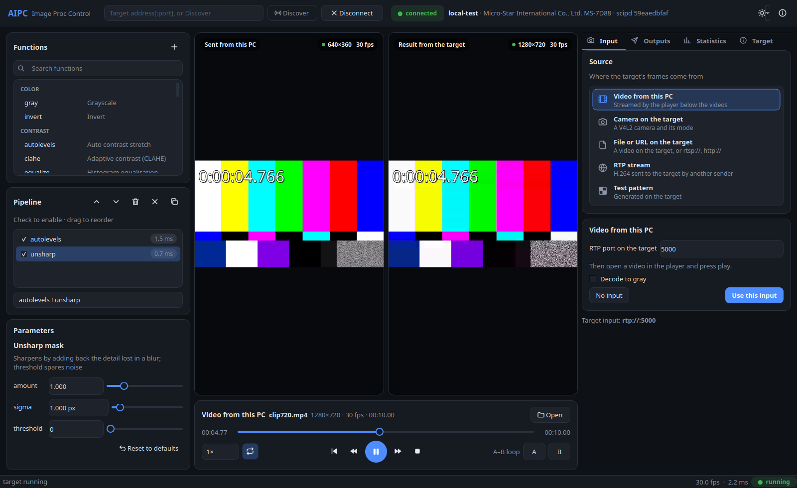
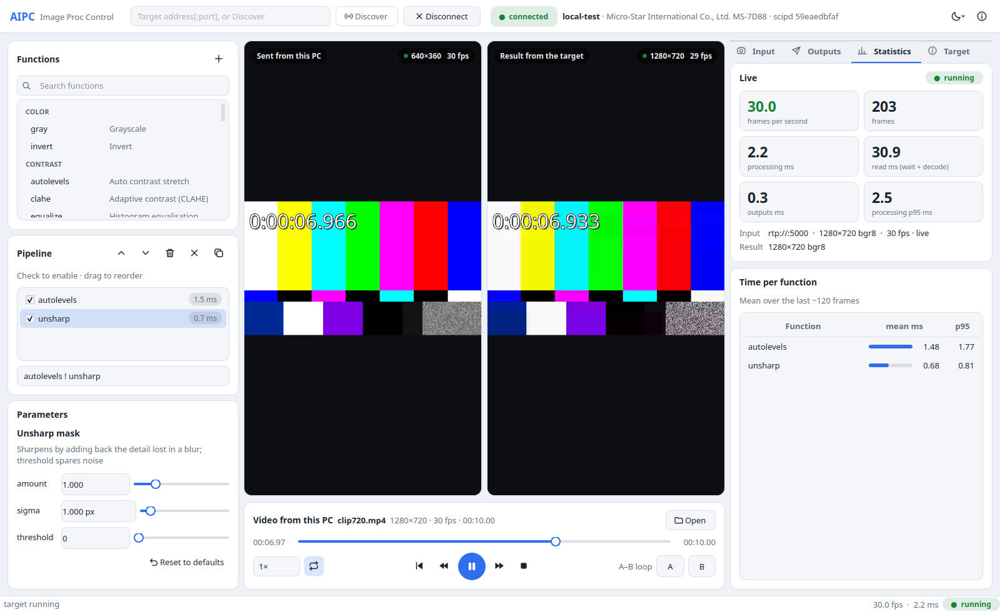

# aipc-gui

Host tools for `scipd` targets (the PC itself or a board), over AIPC, the
AMC Image Proc Control protocol ([docs/aipc-protocol.md](../../docs/aipc-protocol.md)):

- `aipc-gui`: the GUI. It finds targets and shows what they are. You can build
  the pipeline from the functions the target offers, choose its input and
  outputs, stream a video file to it (play, pause, seek, speed, loop, A-B loop),
  and watch the result.
- `aipc`: one AIPC call from the shell, for scripts and quick checks.



## Setup

Python packages come from PyPI through [uv](https://docs.astral.sh/uv/).
GStreamer comes from the system's Python bindings (`python3-gi`), so the
virtual environment must see the system packages:

```bash
sudo apt install python3-gi gir1.2-gstreamer-1.0 gir1.2-gst-plugins-base-1.0 \
    gstreamer1.0-plugins-good gstreamer1.0-plugins-ugly gstreamer1.0-libav
cd host/aipc-gui
uv venv --system-site-packages --python /usr/bin/python3
uv sync
```

`uv sync` keeps the existing `.venv`, including its access to the system
packages.

Why not PyGObject from PyPI? It compiles against the system's GLib and
GStreamer headers (`-dev` packages, a C toolchain). The system copy already
matches the installed GStreamer.

## Use

```bash
uv run aipc-gui                       # finds targets on the LAN
uv run aipc-gui --target 192.168.50.2
uv run aipc --discover
uv run aipc 192.168.50.2 system.info
uv run aipc 192.168.50.2 pipeline.set '{"text": "gray ! blur ksize=5"}'
```

- **Video to the target** (*Input* tab): from this PC as H.264 (bitrate or
  constant quality, preset, key frames) or as raw frames over TCP
  (lossless); or a file the target plays itself, controlled by the same
  player (choose it with the folder button: it lists the target's files).
- **Theme**: dark, light, or like the desktop: the sun/moon button in the
  header (Ctrl+T), or `--theme dark`. The choice is remembered.
- **Keys**: Space play/pause, ←/→ back/forward 5 s, Home to the start,
  Ctrl+O open a video (or drop it on the left view), Ctrl+D discover,
  Ctrl+K connect, Ctrl+F search the functions. The ⓘ button lists them.
- **Remembered** between runs (`~/.config/scip/aipc-gui.conf`): theme, last
  target (preferred when discovering), window layout, the player's folder.



On the target, run `scipd` (the build's `apps/scipd` on the PC, or
`scripts/board-run.sh scipd` for the board).

## Development

The look comes from one place: `theme.py` holds the dark and light colours and
builds a Qt style sheet from them; widgets pick their style by object name
(`card`, `primary`, `muted`...). Icons are small SVGs in `icons.py`, drawn in
the theme's colours. Widgets that paint themselves call `theme.follow()` to
repaint when the theme changes.

```bash
uv run pytest          # starts the scipd of build/host-debug (or $SCIPD)
uv run ruff check . && uv run ruff format --check .
```
